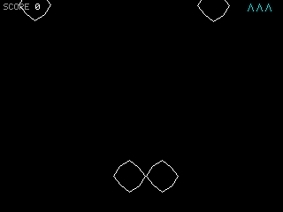
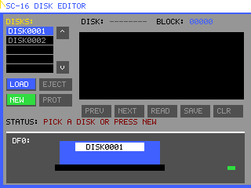
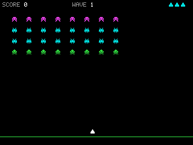

# SuomiCPU-16

SuomiCPU-16 is an emulator for the SC-16, a small, byte-addressed machine. The
Rust emulator is the primary runtime; Python implementations remain during the
ongoing migration.

## Features
- Full emulation of the SC-16 architecture.
- Integrated assembler for SC-16 assembly language.
- C90-oriented compiler for SC-16 with partial language/preprocessor and
  standard-library support (`setjmp.h` and `signal.h` are not implemented),
  plus a target-specific C99 `<stdint.h>` header
  (not a fully conforming C90 implementation; see the
  [user guide](user_guide.md#9-ansi-c90-compiler)).
- Memory-mapped console, BIOS data-disk selection, JSON-backed virtual disks,
  module-sandboxed file reads, a layered GPU with 640x480x4-bit VRAM, hardware
  tile/sprite engines, and a fixed-point 3D graphics coprocessor.

## Getting Started
Install Rust and Cargo, then start the emulator with:

```console
cargo run --bin suomicpu16
```

Start SC-16 without arguments to show the BIOS module selector. Select a
module folder from `modules/` to compile and load its C program into memory.
Folders with multiple `.c` files use `main.c` as the entry source. Press **D**
to cycle through available data disks or choose no disk; virtual disks store
application data only.
Use `--disk ID` to preselect a data disk in BIOS, or mount it with a directly
launched program.
The game fills its own window by default. The 80×25 console opens in a separate
window with **REBOOT**, **RESET** (return to BIOS), **COPY**, and
**PAUSE/CONTINUE** controls and emulator status. Select console text and press
Ctrl+C to copy it; **COPY** copies the selection or the visible screen. The
console retains 1,000 rows of scrollback, accessible with the mouse wheel.
Press **F2** in the emulator window to hide/show the console; **F11** toggles
windowed/fullscreen game display. Start directly in fullscreen with
`cargo run -- --fullscreen` or `.\run.ps1 -Fullscreen`.
Detailed stage logs are on by default and show which SC-16 component is
processing each source file, including compiler, assembler, include, and
memory-loading stages. Use `--quiet` to hide these details.

Run an example directly from the repository root:
```console
cargo run -- examples/example.asm
```

For five analog clock styles, a Nixie-tube display, and a flip clock, run:
```console
python tools/c_compiler.py examples/anaclock.c -o anaclock.bin
cargo run -- anaclock.bin
```
Press Tab to cycle through the seven clock faces.

For a first-person Elite-style space combat demo, run:
```console
python tools/c_compiler.py examples/elitedemo.c -o elitedemo.bin
cargo run -- elitedemo.bin
```
Turn with Left/Right, increase or decrease throttle with Up/Down, and fire with
Space. The ship accelerates and drifts with inertia; shields regenerate and the
laser needs time to cool.

Select **Hertta-3D** in the BIOS for a first-person maze game rendered with the
SC-GPU. Use W/S to move, A/D to turn, and Space to throw treats toward Hertta;
feed her enough treats and wait for her to reach you to advance to a harder
maze. Each visible wall cell is rendered as one outlined surface, and a solid-cell
minimap shows the connected maze and marks you and Hertta. Hertta wanders through
the passages and can find a path to you after eating enough treats. Its source is
[`modules/Hertta-3D/hertta3d.c`](modules/Hertta-3D/hertta3d.c).

On Windows, the PowerShell launcher can run the same programs:
```powershell
.\run.ps1 .\examples\example.asm
```
It changes to the repository directory and starts the Rust emulator through
Cargo. Make sure Rust and Cargo are available on `PATH`.

The emulator accepts assembly (`.asm`), C (`.c`), and flat binary (`.bin`)
programs. Assembly is built natively by Rust. The Rust C compiler currently
handles multiple `int` functions with up to three parameters and local `int`
variables, assignments, arithmetic/bitwise/shift/logical and signed comparison
expressions, conditional expressions, `if`/`else`, nested blocks, and
`while`/`do`/`for` loops with `break` and `continue`, including recursive
calls. Programs outside this subset are rejected with a Rust compiler
diagnostic; the emulator no longer invokes Python to build C sources. The
Python compiler remains in the repository as migration reference code, not as
a runtime fallback. To compile a C file explicitly with the legacy tool:

```console
python tools/c_compiler.py examples/asteroids.c -o asteroids.bin
cargo run -- asteroids.bin
```

See the [user guide](user_guide.md) for setup details, controls, and the full
example catalog.

## Rust emulator port

The Rust port uses Macroquad for graphics and can be compiled for native
systems or `wasm32-unknown-unknown`:

```console
rustup target add wasm32-unknown-unknown
cargo build --target wasm32-unknown-unknown
```

The browser build is not yet a standalone web release: module discovery and
module file access still rely on the host filesystem. Rust builds `.asm`
programs with its native assembler and compiles the documented subset of `.c`
files directly. Unsupported C programs are rejected; there is no Python
runtime fallback.

Run a program with optional persistent data-disk and LAN settings:

```console
cargo run -- "modules\Netgame Demo\net_game_demo.c" --net-port 47016
cargo run -- --headless "modules\DiskEditor\disk_editor.c"
```

Build an SC-16 source file into a segmented image using the Rust tools:

```console
cargo run --bin sc16build -- examples\commands.asm
cargo run --bin sc16build -- examples\example.asm example.sc16img
cargo run --bin sc16build -- input.bin output.sc16img
```

In the Rust BIOS selector, press **D** or **Left/Right** to choose no data disk
or an existing virtual disk before starting a module. `--disk ID` preselects a
disk in the BIOS or mounts it when launching a program directly.

Virtual block disks are stored as JSON files in `disks/`. A program's virtual
file area is read from the `disks/` folder beside its source file. Networking
uses UDP broadcast on the selected port in native builds; browser builds do
not provide UDP networking. Use `--disk DISK0001` to mount an existing
`disks/DISK0001.json` for a run.

<!-- module-gif-gallery:start -->
## Module gallery

Each animation captures a module running in the SC-16 emulator.

| Module | Animation |
| --- | --- |
| AnaClock |  |
| Asteroids |  |
| DiskEditor |  |
| Elite |  |
| Hulio |  |
| Infinite CIty |  |
| Lunar Lander |  |
| MotoRobots |  |
| Netgame Demo |  |
| PacMan |  |
| Paint |  |
| SC-16 showcase |  |
| Space Invaders |  |
| SpaceCave |  |
| Text Demo |  |
<!-- module-gif-gallery:end -->

Regenerate the animations for every module folder with a runnable C entry point:
```console
python tools/generate_module_gifs.py
```
Each generated GIF loops continuously with a 15-second cycle by default.
The source module runs for 10 seconds during capture. Use
`--run-seconds` to change the capture window and `--gif-seconds` to set the
total GIF duration; `--fps` and `--capture-fps` adjust sampling. The script
discovers modules from `modules/` each time it runs and updates this gallery.
